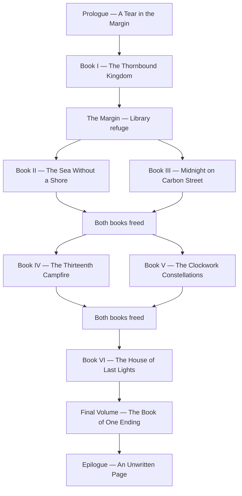

# Papertrails story and campaign design draft

Working story for **Papertrails: The Inkbound**. The campaign follows a paper adventurer through six living genre books and a final volume assembled by a conquering wizard. Each book contains three main chapters, three optional local stories, and a permanent change to the library that connects them. Names and the full campaign scope are proposals; the current game remains the playable foundation.

## The story

The books of the Great Library do more than describe worlds. Their inhabitants build those worlds by living in them. A promise becomes a bridge. A journey unfolds the next stretch of road. A town takes shape when people decide to make a home together. Their experiences settle into ink, becoming the history that later readers discover.

Master Vellum, once the library’s finest book mender, has stolen its Binding Press. He is replacing every book’s living ending with a decree: **And so the wizard ruled, and nothing ever changed again.** Pirates lose the tide. Detectives lose the right to question a verdict. Explorers reach only destinations he has already approved. His soldiers stitch the books together into a single empire, with Vellum written into every victory.

Mara, a cartographer living between the books, cuts an adventurer from an unused endpaper to carry a warning. The figure gets up before she can write its instructions. This is the Wayfarer: no assigned role, no ordained ending, and no history beyond the first choice the player makes.

The Wayfarer must break Vellum’s bindings and return each book’s stolen final page. The people of that book decide what to write there. Each final page stays in its own book. Its residents give the Wayfarer a signed bookmark as an invitation to return and a promise of help. Every freed world adds a new room, ally, or passage to the refuge in the library’s margins. Eventually the Wayfarer discovers why Vellum began: he once tried to save a friend whose book was damaged, and could not repair the life already lost. Now he mistakes complete control for protection.

Vellum cannot instantly overwrite a liberated book again. He must finish the Book of One Ending and clamp the entire library inside its binding. The campaign makes that threat increasingly visible through his construction; it does not run a real-time countdown while the player explores.

The central question is **who gets to decide what happens next?** The player earns the power to open possibilities, then must resist the temptation to dictate everyone else’s ending.

The tone is warm, strange, funny, and occasionally unsettling. Torn seams and erased names carry the danger. Rescues, peculiar friendships, and visibly repaired places carry the hope. The campfire tales and gothic book become eerie without requiring gore or abandoning the handmade appearance.

## What makes these worlds paper

| Rule | What it means in the story | What the player sees or does |
| --- | --- | --- |
| Choice unfolds the page | A meaningful decision creates a possible future. | A rescued resident opens a shop; agreeing to travel unfolds a road. Ordinary scenery rises as the Wayfarer approaches. |
| Ink remembers | Settled events cannot simply be rubbed out. | Scars, repairs, and decisions persist. The past can be understood and repaired around, but a dead person cannot be restored by copying a portrait. |
| Every spine holds a genre | Each book has its own expectations and physical vocabulary. | A pirate sea curls like paper waves; a detective city hides evidence beneath carbon copies. |
| Margins hold unwritten possibilities | Vellum’s narration cannot fully command a place that has no assigned text. | Margin routes offer exploration, refuges, and ways around scripted traps. They still have physical dangers. |
| Red thread imposes a role | The wizard binds a person or place to a repeated command. | Red stitches identify coercion. Attacks and story objectives break the binding rather than erase the captive. |
| Repairs leave seams | Saving a world changes it instead of resetting it to a pristine original. | Patched bridges, new windows, mismatched paper, and rescued neighbors remain visible. |

Most ordinary Inkbound enemies are animated commands printed by Vellum. Defeating them scatters their ink and paper. A named captive such as the Warden survives when the binding is broken; the story makes that distinction clear before the fight. The Wayfarer’s blank origin protects their choices from an assigned script, but their paper body can still be hurt, trapped, and torn.

The camera’s pop-up effect represents the Wayfarer entering a page’s attention. Places do not lose their inhabitants or history when they fold out of view. This keeps the beautiful folding animation from implying that people vanish whenever the player walks away.

Creative changes follow readable limits. Fold works at visible creases; Stitch connects marked anchors; Turn exposes the reverse of a selected page; Cut severs the wizard’s red binding; Hold pins an unstable page. These are physical actions the player can learn, not permission to rewrite anything at any time.

## The campaign structure

A **book** is a genre world. A **chapter** is an authored chain of objectives within that book. The **main quest** carries its central conflict forward. **Side quests** give individual characters a future, change a later encounter, or carry a story into another book. The **Margin** is the persistent hub shared by the whole campaign.

The core route is:

Books II and III can be completed in either order. Their bookmarks open the second shelf, where Books IV and V can also be completed in either order. Stitch joins broken star routes and camp bridges; Turn exposes coordinates and the hidden side of cabin walls. Both second-shelf books must be freed before the House: the campfire survivors recover the words of its lost invitation, while Jun’s charts locate its sealed spine. Neither second-shelf book requires the other’s new ability. The Margin stays reachable after every chapter. Earlier books remain explorable after their main story, and their people remember what the player did.

The planned scope is **six genre books plus the final volume: 21 main chapters and 21 optional local stories**, with the prologue before them. This is a campaign design target, not the amount of content currently built.

Each book has a fixed story route surrounded by procedural outskirts, optional discoveries, and repeatable encounters. A quest’s bridge, witness, clue, or boss arena has a stable address. Streaming may unload its scenery, but never removes its quest state. A large world should offer more chances to discover stories; it should not make the player search arbitrary terrain for a required objective.

## The travelling company

**The Wayfarer.** A cutout from blank endpaper, carrying a letter-opening blade and a small lantern. The player chooses a name when the first book asks who saved it. Appearance and equipment become an album of visible patches from other books. The character’s voice comes through a few consequential choices rather than constant quips.

**Mara.** The cartographer and the person who cut out the Wayfarer. She used to work with Vellum and helped map the bindings, believing they would protect damaged books. She admits this after the first book instead of withholding it until a late betrayal. Her arc is learning to make maps with people, rather than drawing their futures for them.

**Ivo Mossmail.** A mushroom courier who can find addresses that have disappeared from ordinary maps. He begins with the existing letter for the last tree. His deliveries gradually connect people across genres, and those replies become invitations to the final rebuilding of the library. His humor comes from treating impossible adventures as a badly organized postal route.

**Pip Wick.** The moth lamplighter who once ate books and now preserves them. His light reveals erased ink and helps residents recover their own names. His required Book I introduction teaches Glimmer; his separate optional lantern quest grants the existing blessing. He must learn that a repair cannot bring every lost light back.

**Sir Alder, the Hollow Warden.** Book I’s guardian, forced by a stitched crown to defend Vellum’s rewritten ending. Defeating the boss frees him. His optional follow-up lets him choose to become the Margin’s gatekeeper. He is the first proof that an enemy can be more than the role the wizard imposed.

**Master Vellum, the Redactor.** An active antagonist whose handwriting, commands, and intrusions appear throughout the campaign. He initially offers the Wayfarer a place as his appointed hero. When that fails, he tries to write the player as a monster, a criminal, and finally a character who has never existed. His motive explains his actions; it does not excuse the people he has controlled.

## Prologue

### A Tear in the Margin

A repair workshop folds shut while Vellum’s red thread travels across its walls. Mara cuts a blank figure free and asks it to carry a message. The player’s first movement leaves the first ink footprint. A lamp goes dark; choosing to help Pip unfolds a small stair that did not exist before.

The Wayfarer collects the letter-opening blade, learns to dodge a clearly marked binding strike, and frees Ivo from a sealed envelope. The workshop tears away from the library. Mara holds a bookmark door open into the Thornbound Kingdom, where the first stolen ending is anchored.

**Exit condition:** reach the bookmark with both companions rescued. This is a short authored introduction, not a combat grind. These are the campaign’s essential companions; their later optional quests add depth and rewards.

## Book I — The Thornbound Kingdom

**Genre:** fairy-tale adventure. **Question:** can someone refuse the role they were given?

The current Heartland and Moonveil assets form this book’s foundations: woodland paths, hamlets, mushroom groves, snowy uplands, blossom gardens, and the ruined castle. Its forest builds itself from promises, until Vellum decrees that no one may leave their assigned page. Roads fold into walls and guards repeat the same orders.

### Chapter 1 — A Road Out of Nowhere

**Main quest: The Missing Road.** Reach Mara’s waystation, help three stranded residents reconnect their paper workshops, and recover the hinge of the collapsed bridge. Learn **Fold** by raising a marked bridge crease while defending its anchors. The residents then choose to reopen the road together, visibly extending the map.

**Outcome:** the ruined castle becomes reachable; Mara’s workshop becomes the first permanent refuge. This chapter replaces the prototype’s opening kill quota with a named place, people to help, and a physical result.

### Chapter 2 — A Kingdom in the Margins

**Main quest: The Unfinished Sentence.** Meet Pip on the required village route and learn **Glimmer** by revealing a faint ink address. Follow its light through the erased village and collect the testimony of its displaced residents. Use Fold to open the castle’s layered walls and reach Queen Else, whose decrees have been replaced by “As the wizard commands.” Give her the missing text; she chooses to free the roads rather than reclaim obedience.

**Outcome:** the castle changes from a hostile maze into an approach to the Warden. Vellum speaks directly through a page caption and offers the Wayfarer a crown in exchange for silence. The refusal is the campaign’s commitment point, not a false ending choice.

### Chapter 3 — The Knight Beneath the Crown

**Main quest: A Guardian Unbound.** Enter the Moonveil courtyard, survive the Warden’s telegraphed sweeps, and break the red stitches around its crown. Each broken stitch reveals a remembered duty to protect the kingdom’s people. Defeat the binding and let the guardian lower his own weapon.

**Outcome:** recover this book’s final page. Queen Else and the residents write their own departure decree. The fallen castle wall unfolds into a gate back to the Margin. Vellum is revealed as the larger enemy; the Warden is the first book boss.

### Side quests

| Story | Player actions | Reward and later consequence |
| --- | --- | --- |
| **A Letter for the Last Tree** — Chapter 1 | Escort Ivo to two missing trail signs, free the roots from red stitching, then deliver the birthday letter. Combat occurs along the route without a generic kill requirement. | Keep the prototype’s 65 gold and tonic reward. The tree grows an address branch that opens Ivo’s later deliveries. |
| **The Moth and the Missing Dawn** — Chapter 2 | Find three extinguished lantern wicks in an abandoned orchard and help Pip relight them in the order remembered by its residents. | Keep Pip’s existing damage-reduction blessing. A resident’s name reappears in the village and later supplies a clue in Book VI. |
| **A Knight Without an Order** — After Chapter 3 | After the main boss, recover Alder’s shield and ask where he wants to stand guard. Defend his journey if he chooses the Margin. | A shield cosmetic and an optional gatekeeper in the hub. Alder protects a side entrance in the finale; the main route works without him. |

**New tool:** Fold. **New wordcraft:** Glimmer. **Next books:** The Sea Without a Shore and Midnight on Carbon Street, in either order.

## Book II — The Sea Without a Shore

**Genre:** swashbuckling adventure. **Question:** who gets to choose the destination?

Ships unfold from letter paper; wave strips curl across the ground; islands drift on loose map panels. Captain Nell Knott’s crew is trapped in a harbor whose story always ends before departure. Vellum has made himself the owner of the horizon, with Admiral Still enforcing an endless calm.

### Chapter 1 — A Ship Made of Letters

**Main quest: Permission to Depart.** Help Nell recover her crew from customs ledgers and liberate a sail assembled from their confiscated letters. Learn **Stitch** by joining marked sail corners and repairing the gangway. Board the ship by a chain of hand-built docks; this is a compact traversal and melee set piece, not a new sailing simulator.

**Outcome:** the harbor unfolds into open sea. Ivo discovers that letters from other books are being intercepted here.

### Chapter 2 — The Island That Changed Its Mind

**Main quest: Three Possible Shores.** Explore three connected map leaves to find the stolen tide chart. One island wants to remain a sanctuary; another wants visitors. Choose the route of Nell’s voyage with the inhabitants, then stitch the appropriate bridge between leaves. Both routes deliver the chart through different encounters.

**Outcome:** the tide can move again. The selected island becomes the book’s return port, with a different visible settlement and optional encounters.

### Chapter 3 — The Admiral of Still Water

**Main quest: Beyond the Approved Horizon.** Board Admiral Still’s ship while whole strips of sea fold into hazards. Use Stitch to hold a boarding lane, block the admiral’s sabre, and cut the ordinary lashings around the captured tide bell. The red master binding breaks when the admiral is defeated.

**Outcome:** the crew rings the bell and writes a voyage with no fixed last port. Its final page reveals a thread route to a book among the stars. Nell establishes a ferry in the Margin.

### Side quests

| Story | Player actions | Reward and later consequence |
| --- | --- | --- |
| **The Monster Under the Map** — Chapter 2 | Follow a supposed sea monster’s attacks to find a tiny paper octopus dragging a huge printed shadow. Repair its torn home instead of killing it. | It opens a hidden salvage bay and later carries a rescue line during the final evacuation. |
| **The Treasure Nobody Buried** — Chapter 1 | Trace conflicting treasure maps to three crew members’ lost belongings. Return each rather than combine them into a meaningless prize chest. | A weapon upgrade material and a shared cabin mural. Their recovered stories identify a forged ledger in Book III if it is unfinished, or unlock a post-story case if already freed. |
| **Return to Sender** — Chapter 1 | Help Ivo rescue a sack of undelivered letters from a customs fort and deliver Nell’s invitation to a city with no legal address. | A Margin shortcut and a recurring resident in Book III. This grants an alternate entrance, never the only entrance. |

**New tool:** Stitch. **Campaign gate:** this ending and Book III’s ending open Books IV and V.

## Book III — Midnight on Carbon Street

**Genre:** detective noir. **Question:** who controls what counts as the truth?

A layered city of folded newspaper towers, vellum fog, ink rain, and windows cut like speech bubbles. Everyone is certain the Wayfarer committed a crime that has not happened yet. Vellum has confiscated tomorrow and given Judge Full Stop the power to end any investigation with a stamp.

### Chapter 1 — A Crime in Future Tense

**Main quest: Wanted Before Arrival.** Escape a staged ambush, meet Detective Dot Vale, and inspect three versions of the same arrest notice. Learn **Turn** to reveal the carbon impression on the back of selected pages. Compare the clues on Dot’s case board; a wrong deduction opens a corrective clue rather than failing the campaign.

**Outcome:** prove that the accusation was printed before the crime. Dot joins the investigation and the shuttered district unfolds.

### Chapter 2 — The Witness Who Was a Footnote

**Main quest: Beneath the Official Story.** Find a witness the magistrate has reduced to tiny text at the bottom of a page. Follow a margin route into the newspaper press, turn a locked panel, and restore the witness’s name to the city register. They choose to testify; the player cannot force it by selecting a rewrite command.

**Outcome:** discover that Vellum is copying his own perfect ending into every book. Recover the reverse-side coordinates needed to read the star volume.

### Chapter 3 — The Trial of Tomorrow

**Main quest: The Right to an Unwritten Day.** Bring evidence to the courthouse, dismantle contradictory charges, then battle Judge Full Stop on a courtroom that stamps its own floors shut. Telegraphs remain honest even when the narrator lies. Turn designated docket pages to expose the judge’s binding anchors between melee phases.

**Outcome:** the city wins the right to publish tomorrow’s edition without knowing its contents. Its final page restores a library catalogue entry that Vellum erased. Dot opens a case desk in the Margin.

### Side quests

| Story | Player actions | Reward and later consequence |
| --- | --- | --- |
| **The Shadow on Strike** — Chapter 1 | Investigate a lamplighter whose paper shadow has refused to follow orders. Negotiate separate working hours and repair their shared lamp. | A shadow-pattern cloak and an optional route past a later searchlight. |
| **A Name in Small Print** — Chapter 2 | Recover the bylines of cleaners and printers removed from the newspaper’s credits. Defend the press while they publish their names. | A visible citizen-run newspaper and an additional witness at the trial. The main case remains solvable without them. |
| **The Case of the Missing Color** — Chapter 2 | Trace a stolen red pigment through three scenes, then choose which neighborhood receives the first restored mural. | A custom equipment dye and a changed district. The mural’s painter later helps the Book V astronomer mark a safe landing path. |

**New tool:** Turn. **Campaign gate:** combine its catalogue entry with Book II’s thread route to open Books IV and V.

## Book IV — The Thirteenth Campfire

**Genre:** scary campfire anthology and woodland folklore. **Question:** who owns a story once somebody has told it?

Twelve storytellers gather around a fire in a book of short scary tales. When the flames rise, a thirteenth shadow appears beside an empty stool. Vellum has torn out the last lines so that the dangers never resolve: the footsteps keep following, the cabin never lets its guests leave, and the fire keeps asking for another name. Unfinished creatures have escaped their stories into the woods between them.

**Keeper Cinder**, a ranger made from charcoal rubbing and patched field-guide paper, tends the camp. Her lantern has a sliding letter stencil; her cloak unfolds into a small shelter. She can guide the player but cannot finish other people’s tales for them. **Rue**, a young storyteller with a stitched notebook, insists that frightening stories can help people face uncertainty rather than obey a reassuring lie. Cinder’s dry humor and a tiny Marshmallow Knight give the chapter room to breathe between scares.

This book is about suspense, strange rules, and stories told together. The later House of Last Lights is about grief, memory, and the wizard’s past. Their environments, monsters, and emotional roles should remain distinct.

### Chapter 1 — The Footsteps That Follow

**Main quest: One More Step Than You.** Find Rue, whose trail has been joined by an extra pair of footsteps. Cinder teaches **Hush** at a safe clearing: silence your own steps briefly, then identify the steps that continue without you. Their rhythm also appears as ground ripples and captions. Glimmer reveals fresh ink footprints; old printed footprints stay dull. Follow the true trail, fold a fallen sign into a bridge at its crease, and free Rue’s notebook from a stalking figure’s binding knot.

The **Footstep Thief** is a tall accordion-paper figure. Before its lunge, its extra legs stamp twice and its body compresses along visible folds. Its ground warning remains honest. Hush helps locate it; dodge or guard and a short melee opening resolve the encounter. Reaching a marked lantern circle also breaks pursuit, so finding the clue does not demand a perfect duel.

**Outcome:** Rue chooses and speaks the story’s missing last line. A trail folds back to camp, the false steps stop, and the first stolen name returns to a place card. The player learns that these creatures are repeating unfinished instructions.

### Chapter 2 — The Cabin with One Window Too Many

**Main quest: Count from the Outside.** A cut-paper cabin has three windows outside and four inside. Compare its exterior silhouette with interior fold panels, Turn the reverse of a loose wall to reveal the extra window’s red caption, then Fold marked shutters until moonlight reaches the actual door. Stitch a torn floor between the two safe rooms. Wrong arrangements give clear feedback and can be reset without spending a limited resource.

The **Window Guest** is a folded face that migrates between window frames. Its eyelid creases shut before a shutter slam; loose letters gather in the dangerous frame. The player may lure it into the false window and close the paper flap, or withstand its attacks while solving the same arrangement. Striking it alone cannot unlock the cabin. Required clues are available outside combat, and opening the puzzle journal pauses the encounter.

**Outcome:** rescue the trapped storyteller and learn **Echo** from their speaking-tube lantern. Replay a selected in-world sound at a marked anchor to lead the Guest away from the exit. The cabin unfolds into a shelter whose windows now agree on both sides of the page.

### Chapter 3 — Don’t Let the Fire Learn Your Name

**Main quest: The Empty Place at the Fire.** Return to find the thirteenth shadow wearing letters from the storytellers’ names. Recover three name fragments from nearby tale clearings, using the clues and paths already learned. Place the fragments on their owners’ place cards; the residents supply their own final lines. No free-text password or knowledge from outside the game is required.

The **Listener in the Ash** rises from layered charcoal paper, loose quotation marks, and a cloak of unfinished sentences. Echo can lure its listening head toward a lantern; Glimmer exposes the seam beneath its letters. Hush interrupts its clearly marked voice-copying channel, while dodge and guard handle the physical attacks. Those attacks also expose melee openings, so a player who has spent their combat ink is never trapped waiting for a spell. Finish by breaking the red binding knot beneath the empty stool, not by burning the storytellers’ book.

**Outcome:** the residents write different endings for their own tales. Cinder preserves the frightening parts; fear no longer guarantees the wizard’s victory. The thirteenth stool becomes a place for an invited guest. Their signed bookmark carries the recovered words of the House’s lost invitation. A firepit and storytelling circle unfold in the Margin.

### Side quests

| Story | Player actions | Reward and later consequence |
| --- | --- | --- |
| **The Marshmallow Knight** — Chapter 1 | A tiny folded knight on a roasting stick wants to protect the camp’s toast. Fold a windbreak and redirect drifting sparks with a hinged fan, then help it face a soot moth stealing the provisions. | A toasted-edge shield cosmetic and a comic camp resident. It guards supplies during the final evacuation; no main-route protection depends on it. |
| **The Lantern on the Lake** — Chapter 2 | Follow a lantern visible only in the lake’s paper reflection. Turn a floating map, align two folded reeds, and send a paper boat carrying an unanswered letter to the far bank. | Recover a missing scout’s name and deliver it to their surviving friend. A reflected-lantern charm and a memorial appear; the quest does not resurrect the scout. |
| **Letters Under the Sleeping Bag** — Chapter 1 | Ivo’s letters have become nesting material for tiny comma creatures. Observe what they collect, fold a safer paper house, and exchange blank scraps for the letters. Fighting them is unnecessary. | A decorated satchel, returned correspondence, and extra invitations displayed in the Margin. Missing this quest never withholds the House’s required invitation. |

**New wordcraft:** Hush and Echo; Glimmer is introduced in Book I. **Campaign gate:** this ending and Book V’s ending open The House of Last Lights. Cut is not needed in this book; its local binding knots can be loosened or struck using ordinary melee. Red master stitches elsewhere still require Cut.

## Book V — The Clockwork Constellations

**Genre:** science fantasy and planetary adventure. **Question:** is a future worthwhile if nobody may discover anything new?

Planets are layered paper discs connected by stitched star paths. Spacesuits use folded collars, ships use foil panels, and observatories resemble movable star charts. Astronomer Jun Six has found an unknown star, but Vellum’s Celestial Engine repeatedly resets any expedition that leaves an approved orbit.

### Chapter 1 — A Star Outside the Chart

**Main quest: The Unapproved Expedition.** Turn the star chart to reveal its missing coordinates, stitch a route across its torn panels, and help Jun launch a small expedition. Fight on exterior ship pages as they unfold; travel between planets happens through authored transitions rather than a separate flight game.

**Outcome:** reach an uncharted moon and discover discarded prototypes of Vellum’s binding machinery.

### Chapter 2 — The Factory of Perfect Futures

**Main quest: Cut Along the Dotted Lie.** Rescue mechanical explorers from an assembly line that stamps the same life onto each of them. Recover a seam-cutting edge and learn **Cut**, which lets any equipped melee weapon sever marked red master stitches. Use it on three machine locks while choosing where to divert the freed workers.

**Outcome:** the reset network loses control of the expedition. Jun finds evidence that Vellum’s first failed repair came from a different, long-closed book.

### Chapter 3 — An Orbit of Our Own

**Main quest: Break the Celestial Engine.** Fight an instrument-like sentinel that rotates the arena between predictable orbital lanes. Fold cover, stitch broken platforms, and cut its exposed red control threads after each committed attack. The explorers choose their next destination while the engine can no longer reverse them.

**Outcome:** the recovered final page points to the House of Last Lights, the source of Vellum’s fear. A planetarium unfolds in the Margin and shows the last approach to his press.

### Side quests

| Story | Player actions | Reward and later consequence |
| --- | --- | --- |
| **The Robot Who Wanted a Name** — Chapter 2 | Escort a numbered scout through three places where it can try different kinds of work, then ask what name it has chosen. | A tool charm and a named resident in the hub. It repairs an optional machine route in the finale. |
| **The Smallest Moon** — Chapter 1 | Find a loose moon mistaken for scrap, repair its orbit, and ask its inhabitants where they want to travel. | A moving exploration landmark, rare paper for armor, and a small recurring moon over the Margin. |
| **Signals From the Endpaper** — Chapter 2 | Follow a distress signal through turned chart panels and stitch together an abandoned rescue capsule. | Rescue a keeper carrying a memory of Vellum’s first book. Their testimony adds context in Book VI; the essential revelation is still on its main route. |

**New tool:** Cut. **Campaign gate:** free this book and The Thirteenth Campfire to open The House of Last Lights. No campfire spell is required here.

## Book VI — The House of Last Lights

**Genre:** gothic mystery and ghost story. **Question:** can we preserve a memory without imprisoning the people who remain?

A mansion rises from a memorial album. Portraits are translucent layers; rooms recur with one detail missing; red thread keeps the last evening repeating. Vellum’s lost friend Ada was the lantern keeper in this book. When its pages were damaged, she held a passage open so others could escape. He tried to repair her by reconstructing that night, then began forcing every other story to avoid loss.

### Chapter 1 — Guests Who Cannot Leave

**Main quest: A Welcome Without an Exit.** Enter the mansion, find residents trapped in rehearsals of the same evening, and collect the invitations that explain their different memories. Meet the housekeeper, Miss Hem, who has been ordered to keep every room exactly as Ada left it.

**Outcome:** the player learns that the repetitions are imposed copies, while the surviving residents have real lives of their own.

### Chapter 2 — The Night the Page Tore

**Main quest: What the Ink Remembers.** Reconstruct the damaged evening from the residents’ accounts. Pip can reveal the ink left beneath repairs, and optional earlier memories add detail. Learn **Hold** with Ada’s surviving bookmark: pin a marked page open while the surrounding house folds, then escort the remembered evacuation route.

**Outcome:** learn that Ada chose to save others and that Vellum cannot undo the settled loss. Vellum arrives and offers to make a flawless copy of anyone the Wayfarer misses. The story acknowledges why this is tempting without presenting the copy as the person restored.

### Chapter 3 — A Door Left Open

**Main quest: The Last Guest.** Battle the Last Host, a mannequin made from Vellum’s repeated attempts to recreate the evening. Hold safe exits open through its room-changing attacks, cut the red bindings, and let the survivors leave at their own pace. Miss Hem chooses which rooms become a memorial and which become homes again.

**Outcome:** the final page records both the loss and the lives that continued. Ada’s bookmark can hold open a breach in the Binding Press. Vellum abandons persuasion and begins printing his final volume.

### Side quests

| Story | Player actions | Reward and later consequence |
| --- | --- | --- |
| **The Portrait That Refused to Smile** — Chapter 1 | Find the fragments of a portrait that the Host keeps altering into a happy expression. Restore the subject’s chosen expression. | A room opens and an honest memory joins the gallery. The reward affirms the person’s choice rather than grading it as a happy ending. |
| **A Bed for the Boogeyman** — Chapter 1 | Help a frightening folded creature find a room where it will not be forced to scare children. Gather soft backing paper and resolve a dispute with the occupants. | A rest alcove and an optional guardian for an evacuation passage. |
| **Pip’s Last Lantern** — After Chapter 2 | Visit the orchard resident from Book I if their name was restored; otherwise find their account in the house register. Help Pip light a memorial lamp that cannot bring Ada back. | A lantern cosmetic and a warm, permanent room in the Margin. Earlier completion changes the conversation and adds a witness, not access to the quest. |

**New tool:** Hold. **Final gate:** the six signed bookmarks, the rescued Margin, and Ada’s bookmark open the Binding Press.

## Final Volume — The Book of One Ending

**Genre:** Vellum’s forced anthology. **Question:** who will hold the pen after the wizard falls?

Vellum has stitched incompatible worlds together: a courtroom over a pirate deck, a castle tower through a star chart, a haunted corridor inside a market, a campfire whose smoke has become the courtroom’s testimony. Every chapter concludes with the same statue of him. The people and genres resist being reduced to scenery in his story.

### Chapter 1 — Every Road Leads to Me

**Main quest: Find the Unwritten Route.** Use the freed books’ signed bookmarks to open the anthology with their residents’ help. Vellum’s captions try to redirect the Wayfarer toward his throne. Fold a road around one decree, Turn another to expose its omitted clause, and Stitch a route across the gap. Rescued characters offer optional paths; essential tools always provide a base route.

### Chapter 2 — The Library That Fought Back

**Main quest: Give the Pages Room.** Hold open three evacuation passages while the wizard collapses their book seams. Main-story allies from every freed book arrive. Side-quest allies change who appears, add shortcuts or supplies, and reduce environmental pressure. Cut the press’s six binding lines before it can clamp the liberated books into a single spine.

### Chapter 3 — The Right to the Next Page

**Main quest: Break the Author’s Throne.** Vellum fights with a quill staff and a paper-cutting blade. He attempts to impose a role on the Wayfarer between clearly telegraphed attacks: hero who kneels, villain who must be destroyed, blank figure who never mattered. His arena draws on the learned paper tools. Ordinary melee openings remain central; dialogue cannot replace learning the fight.

Defeating him frees the pen. The last required act is to place it in the Margin’s shared writing desk instead of using it to prescribe everyone’s future. This is the campaign’s earned resolution, not a surprise moral test with a secret bad ending. The player chooses what the Wayfarer does next: keep travelling, help Mara mend the library, or build a home. All preserve the books’ freedom.

Vellum loses the power to dictate lives. The freed residents decide the terms of his confinement or supervised work. The Wayfarer may speak for compassion or distance, but cannot forgive him on everyone else’s behalf.

### Optional stories in the final volume

| Story | Player actions | Consequence |
| --- | --- | --- |
| **The Names in the Credits** — Chapter 1 | Rescue displaced printers from a collapsing credits roll. Return their names to the books they helped create. | More residents appear in the rebuilt library and the credits become a walkable epilogue gallery. |
| **One Last Delivery** — Chapter 2 | Carry the replies from Ivo’s completed deliveries through a storm of loose pages. Missing optional letters are simply absent. | An invitation wall displays the friendships the player actually made. |
| **The Patchwork Banner** — Chapter 1 | Gather repaired scraps from earlier books and let their residents place them on a shared banner. | A cosmetic records the player’s journey. No combat upgrade or ending is locked behind completion. |

## The side stories that connect the books

| Continuing story | First appearance | Development | Payoff |
| --- | --- | --- | --- |
| Ivo’s impossible addresses | The last tree in Book I | Confiscated letters at sea; a city address restored; letters rescued from a campfire nest; invitations sent through the Margin | Actual correspondents arrive to help rebuild, with replies displayed in the epilogue. |
| Pip’s lost lights | The orchard in Book I | Erased names in Book III; stolen names around Book IV’s fire; distant distress lights in Book V | He chooses remembrance over imitation in Book VI and lights the rebuilt library. |
| Mara’s responsibility | Her confession after Book I | Residents correct her maps; she accepts routes she did not plan | The shared desk replaces the lone author’s throne. |

Local side quests resolve in the book where they begin. Later callbacks extend the reward instead of leaving an apparently unfinished quest in the journal. When Books II and III exchange clues, the game checks which has been freed and supplies a useful alternate scene in either order.

Optional quests never supply the only key, witness, tool, or route needed to finish the campaign. Main chapters establish every required ally and revelation. Skipping a side quest changes the company, scenery, and assistance the player encounters; it does not quietly invalidate the ending.

## Wordcraft: a small magic system built from letters

Magic gives the Wayfarer a few reliable verbs. The lantern carries movable letter stencils; casting briefly releases the word as physical ink marks before it resolves into an effect. The player selects a learned word and a clear target. Arbitrary typed sentences are outside the design: a small vocabulary can have many contextual uses without promising that any command will work.

| Word | Where it is learned | Exploration and puzzle use | Combat use and limit |
| --- | --- | --- | --- |
| **Glimmer** | Pip’s required introduction in Book I, independent of his optional blessing | Reveal faint ink, recent footprints, and marked seams inside a short lantern cone. | Briefly outline an already visible weak seam. It does not reveal every secret through walls or remove the need to aim. |
| **Hush** | Cinder’s safe clearing in Book IV, Chapter 1 | Quiet footsteps or a marked bell so another rhythm can be heard and seen. | Brief stealth or interruption of a specifically marked voice channel. It does not cancel every sword swing or freeze an arena. |
| **Echo** | The rescued storyteller in Book IV, Chapter 2 | Replay a selected in-world sound or rhythm at a marked anchor: a knock, a bell, a spoken clue. | Create a decoy sound at a visible location. Enemies show when they notice or reject it. No microphone or recording of the player’s voice is involved. |

Fold, Stitch, Turn, Cut, and Hold remain physical paper tools. Wordcraft reveals, quiets, or repeats information; the tools change the structure of a place. Glimmer can show a crease, but the player still has to Fold it. The same readable verb should work in several genres: Echo rings a pirate bell, tests a noir speaking tube, or calls a clockwork scout.

Use a modest ink reserve for combat casting, with clearly shown costs and recovery during ordinary play. Puzzle experimentation must never consume the only resource needed to continue: marked puzzle casts are free, and safe lantern stations refill ink. Exact charges and cooldowns need playtesting. Every mandatory fight retains melee, guard, and dodge solutions. Optional magic gives extra tactics; the final boss never requires an unavailable or empty spell.

Teach each word in a safe situation, repeat it with one complication, then let the player combine it with a paper tool. Main quests should alternate discovery, physical problem solving, conversation, and short battles. They should not become chains of kill quotas.

A good puzzle follows **observe → try one clear action → see a response → change the place**. Show why a trial failed: an unlit stencil, a snapped sound trail, a hinge that cannot align. Give a reversible reset, a journal sketch, and graduated hints after repeated attempts. Sound clues also have visual rhythms; color clues also have shapes or letters. The player needs to understand the puzzle, not fight the interface.

## Letters, paper effects, and physical space

The campfire book uses orange translucent paper flames, teal moonlit vellum, charcoal tree silhouettes, corrugated roots, and backgrounds made from several separated layers. Tents unfold from envelopes; cabins assemble along visible hinges; distant trees rise one row at a time. Small 3D boxes, cylinders, and faceted shapes still carry paper grain, printed faces, pale cut edges, and visible seams.

| Effect | Appearance | Gameplay purpose |
| --- | --- | --- |
| **Punctuation embers** | Small `.` and `:` marks rise from the fire, with occasional `*` sparks. | A gentle ambient effect; ember drift also points toward a changed wind vane in one puzzle. |
| **Whisper trails** | Loose letters travel along a sound path, then settle into a short readable caption near its source. | Makes Hush and Echo usable without sound and indicates which anchor received the spell. |
| **A sentence in the smoke** | A few words briefly assemble inside layered ash, then scatter at a crease. | Presents clues and the Listener’s stolen words. Essential text remains in the journal long enough to read. |
| **Negative-space monsters** | A face appears through torn paper gaps; quotation marks become eyes before the body unfolds. | A recognizable warning before an enemy enters combat. Damage still uses the existing ground-marker rules. |
| **An ending takes shape** | A recovered last line settles onto the page; tents, paths, or a bridge rise in sequence. | Gives solving a story an immediate, visible consequence. |
| **Paper weather** | Thin strips of rain, curled fog ribbons, and distant letter-shaped moths. | Distinguishes chapters without covering nearby hazards or interaction targets. |

ASCII is an accent and a language for clues, not a full-screen filter over the fight. Use pooled glyph particles, a shared glyph atlas, and a small nearby effect budget when implemented. Keep readable text crisp and separate from decorative fragments. Offer reduced particle and reduced motion settings; avoid rapid flashing. Deception belongs in the story, not in misleading damage warnings.

**Hard paper is still hard.** A cardboard wall, tree trunk, crate, rock, or closed door blocks walking, running, and dodging. Empty areas around a printed cutout do not block the player, and a real arch opening stays passable. Ferns and soft decorative foliage may bend aside. When foreground scenery fades to reveal the hero, its collision stays active.

For future puzzle props, collision must follow the authored physical state: a door stops blocking only after its panel has cleared the doorway; an unfolded bridge becomes traversable when it is stable; folding a bridge away cannot strand the player without a return route. Nearby decorative pop-ups rise before the hero reaches them. Procedural placement must leave connecting paths open by moving the whole prop, rather than carving an invisible walk-through hole into solid artwork.

**Current implementation status:** Moonveil now derives thin collision segments from the solid portions of its printed scenery and keeps movement substeps for fast travel. Wordcraft, the campfire book, its quests, ASCII effects, and interactive puzzle transformations in this document are planned content, not yet playable systems.

## How the map and journal should work

The [world and chapter atlas](ATLAS-GUIDE.md) places battles, puzzles, safe points, optional stories, and rewards across all 21 chapters. The [inventory design](INVENTORY-DESIGN.md) defines equipment slots and ties named weapons, armor, and magic items to those map locations. Both remain design plans for the campaign.

The **library map** shows books as physical volumes on shelves. A sealed book has red stitches; an open one has a bookmark; a freed one has a repaired spine and a visible contribution to the Margin. Selecting a book opens its table of contents.

The **book map** shows authored chapter landmarks connected by unfolding paths, with explored procedural outskirts around them. Named quest locations remain visible once discovered. The existing waystation marker, explored tiles, and zoomable atlas can support the first version.

The **chapter page** states the current situation, the next concrete action, and the place it will change. Main objectives sit on the page; local side stories are attached as margin notes. Completed quests leave a stamp or illustration showing their visible consequence. A chapter closes when its story objective resolves, not when the player reaches a kill count.

For example: **The Missing Road → Find the bridge hinge at the abandoned mill → Return to Mara’s crossing → Fold and defend the bridge → The residents open the castle road.** A player should always know both what to do next and why it matters.

Bosses and hostile transformations use the existing attack-warning language in every genre. A false narrator can lie about motives, but cannot lie about the ground marker where damage will land. Sword, axe, spear, guard, and dodge carry across books. Genre-specific props change their appearance and the encounter design without demanding separate combat systems.

## A practical first release

The full seven-volume arc is the long-term campaign. The first playable story release should complete the prologue and Book I, plus a small Margin with sealed previews of Books II and III.

1. Establish stable book, chapter, quest, and objective records. Store their progress separately from combat XP and kills.
2. Add Mara’s opening conversation, the Missing Road objective chain, and a bridge that permanently changes after the quest.
3. Replace the opening kill quotas with the castle route and the Warden’s binding objectives. Keep existing rewards and combat progression.
4. Rewrite Ivo’s delivery and Pip’s lantern quest around places and actions. Preserve rewards already earned in existing saves; do not make a returning player lose a blessing or pay for the same reward twice.
5. Add the Warden’s liberation, a short ending scene for Book I, and the first room of the Margin.
6. Build a table of contents and quest journal that show chapter dependencies and visible outcomes.
7. Once this loop feels good, build one 10–15 minute campfire tale as a separate prototype: a lantern trail, one sound puzzle, one readable enemy, and a physical paper transformation. Prove Glimmer and Hush before adding Echo or an entire spell menu. This development order does not change the campaign’s book order.
8. Build a single Book II chapter to prove that the same character, combat, and paper interactions work across genres.

Existing Moonveil regions remain terrain within Book I until separate genre books are built. Their current labels do not yet represent the six genre books. The streamed-world system supplies the surroundings; authored quest landmarks supply the story’s direction.

A useful first milestone is complete when a player can meet Mara, understand the missing road, help its residents, unfold the bridge, see the castle route appear, and find the next objective without guidance outside the game.
